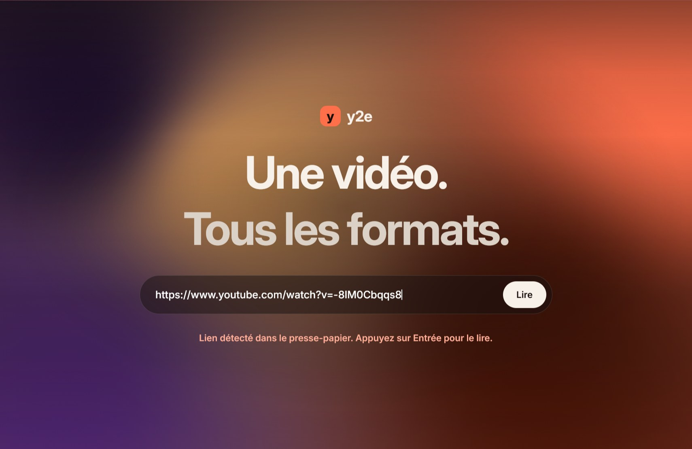
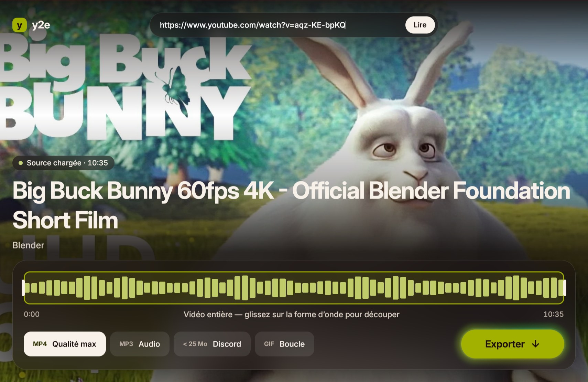

# YouTube to Everything

Télécharger une vidéo YouTube, n'en garder que le passage qui compte, et l'exporter dans le format dont on a besoin. Une vitrine du framework GPU [Rune](https://github.com/anomalyco/rune).





## Fonctionnalités

- Le titre, l'auteur, la durée et la miniature s'affichent dès que le lien est collé, ou détecté dans le presse-papier.
- On glisse sur la forme d'onde pour choisir le passage, et seul ce segment est téléchargé.
- Quatre exports : MP4 en qualité maximale, MP3, vidéo de moins de 25 Mo pour Discord, et GIF. La taille estimée est affichée. Un gros GIF reste possible, avec une suggestion d'extrait plus court.
- L'accent de l'interface vient de la miniature, qui sert aussi de décor.
- Les fichiers exportés arrivent dans le dossier Téléchargements.

## Installation

Les versions publiées (page Releases) sont des archives Linux x86_64 :

```bash
tar -xzf y2e-vX.Y.Z-linux-x86_64.tar.gz
cd y2e-vX.Y.Z-linux-x86_64
sh install.sh              # binaire, entrée de menu et icône, pour l'utilisateur courant
sh install.sh --uninstall
```

Chaque archive est publiée avec sa somme SHA-256 (`sha256sum -c y2e-*.sha256`).

## yt-dlp et ffmpeg

y2e s'appuie sur `yt-dlp` et `ffmpeg`. Il utilise ceux du `PATH`. S'ils manquent, l'accueil propose de les installer (Linux x86_64 et aarch64) : environ 190 Mo à télécharger et 390 Mo sur disque, dans `~/.local/share/y2e/bin`, chaque fichier étant vérifié par sa somme de contrôle.

Au lancement, y2e cherche en arrière-plan une version plus récente de `yt-dlp` et propose de la mettre à jour. Si la copie vient de votre gestionnaire de paquets, y2e l'annonce sans y toucher. La copie de `ffmpeg` installée par y2e est proposée au renouvellement après 4 mois.

## Raccourcis clavier

| Touche | Action |
| --- | --- |
| Entrée (dans le champ) | Lire la source |
| Tab | Passer d'un contrôle à l'autre |
| Entrée (ailleurs) | Exporter |
| ← → | Déplacer la fin du passage de 1 s (↑ ↓ : 10 s) |
| Maj + flèches | Déplacer le début au lieu de la fin |
| Origine | Reprendre toute la vidéo |

Les flèches agissent dès qu'une source est chargée, sans avoir à sélectionner la timeline, sauf pendant la saisie dans le champ du lien.

## Compiler depuis les sources

Il faut Rust et `curl`. Sous Linux, la compilation demande aussi `libxkbcommon-dev` (ou l'équivalent de votre distribution).

```bash
cargo run --release -p y2e-gui
```

`cargo build --profile dist -p y2e-gui` produit le binaire de livraison : compilation plus longue, exécutable environ 40 % plus petit.

## Organisation

```
crates/
├── y2e-core/   moteur : yt-dlp, ffmpeg, presets, progression (aucune dépendance graphique)
└── y2e-gui/    interface Rune : vues, effets GPU, couleurs
packaging/      entrée de menu, icône et script d'installation
scripts/        release.sh
specs/          spécifications des fonctionnalités
```

Le moteur et l'interface échangent des événements typés (`CoreEvent`) : une autre interface peut s'ajouter sans modifier le moteur.

## Développement

```bash
cargo test --all
cargo clippy --all --all-targets -- -D warnings
cargo fmt --all --check
```

La CI (`.github/workflows/ci.yml`) lance ces trois commandes à chaque push et pull request.

## Publier une version

Les messages de commit suivent les [Conventional Commits](https://www.conventionalcommits.org) : ce sont eux qui forment les notes de version.

```bash
scripts/release.sh 0.2.0     # version, CHANGELOG.md, commit et tag local
git push --follow-tags       # le tag lance la publication
```

Le workflow `Release` (`.github/workflows/release.yml`) rejoue les tests, compile avec le profil `dist`, publie l'archive, sa somme SHA-256 et les notes de la version. Un tag contenant un tiret (`v0.2.0-rc1`) est publié comme pré-version. Il faut avoir installé `git-cliff` (`cargo install git-cliff`) pour lancer le script.
