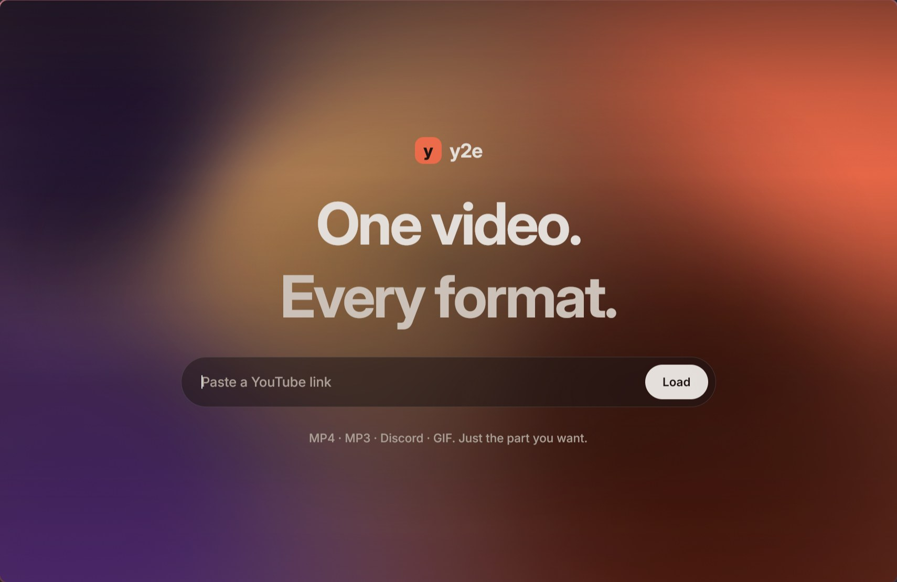
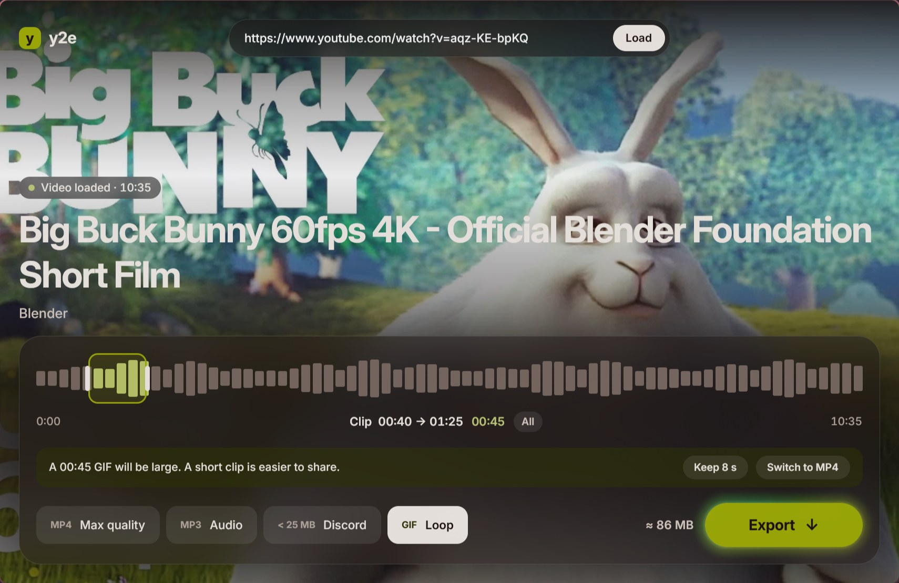
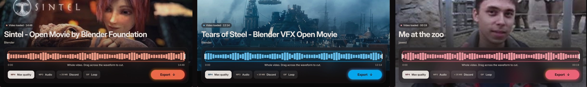

<div align="center">


# YouTube to Everything

Download a YouTube video, keep only the part you want, and export it in the format you need.

[](https://github.com/MedCy1/Youtube-To-Everything/actions/workflows/ci.yml)
[](https://github.com/MedCy1/Youtube-To-Everything/releases)


[Installation](#installation) · [Features](#features) · [Keyboard shortcuts](#keyboard-shortcuts) · [Build from source](#build-from-source) · [Contributing](#contributing)

<br>


</div>

## Overview

y2e (YouTube to Everything) is a desktop application for turning a YouTube video into a file you can actually use: an MP4, an MP3, a clip small enough for Discord, or a GIF. You paste a link, drag across a waveform to choose the passage you care about, pick a format and export. Only the selected segment is downloaded, so a short clip from a long video takes a fraction of the time a full download would.

The interface is native and GPU rendered. The window appears in about 150 ms, the studio view draws nothing while it is at rest, and the colours come from the video's thumbnail.

<div align="center">

</div>

## Features

### Cut before you download

Dragging on the timeline selects the passage to keep. The whole video stays selected until you move a handle, and the arrow keys nudge either end by a second at a time. Because the cut happens at the source, y2e never downloads the part you throw away.

<div align="center">

</div>

### Four exports

| Preset | Output | How |
| --- | --- | --- |
| Max quality | MP4 | The best video and audio streams, merged without re-encoding where possible. |
| Audio | MP3 | The audio track alone, at the highest quality setting. |
| Discord | MP4 under 25 MB | H.264 and AAC, with the video bitrate worked out from the length of the clip so the file fits the limit. |
| Loop | GIF | 15 frames per second, 480 pixels wide, with an optimised palette. |

The estimated size is shown before you export. Nothing is ever blocked: a very large GIF is still possible, and y2e only suggests a shorter clip.

### An interface that follows the video

The thumbnail fills the window and the accent colour is derived from its dominant hue, at a fixed lightness so text and controls stay readable whatever the video.

<div align="center">

</div>

### Built for the keyboard

Every control can be reached and named for screen readers, shows a focus ring, and the cut can be adjusted without touching the mouse. A YouTube link found on the clipboard when the window comes to the front is offered straight away. See the [shortcuts](#keyboard-shortcuts).

### It looks after its own tools

y2e drives `yt-dlp` and `ffmpeg`. It uses the ones on your `PATH`, and if they are missing it offers to install them for you, then checks for newer versions of `yt-dlp` at launch. See [yt-dlp and ffmpeg](#yt-dlp-and-ffmpeg).

### Clear errors

Tool failures are turned into one plain sentence ("This video is not available.", "Could not connect. Check your network."). The technical detail only appears when the error is not recognised.

## Installation

Release archives are published for Linux x86_64 on the [Releases](https://github.com/MedCy1/Youtube-To-Everything/releases) page.

```bash
tar -xzf y2e-vX.Y.Z-linux-x86_64.tar.gz
cd y2e-vX.Y.Z-linux-x86_64
sh install.sh
```

`install.sh` copies the binary to `~/.local/bin`, and adds a menu entry and an icon for the current user. Run `sh install.sh --uninstall` to remove them. Each archive comes with a SHA-256 checksum:

```bash
sha256sum -c y2e-vX.Y.Z-linux-x86_64.tar.gz.sha256
```

Requirements: a Wayland or X11 session, and a GPU driver with Vulkan or OpenGL support.

## yt-dlp and ffmpeg

y2e relies on [`yt-dlp`](https://github.com/yt-dlp/yt-dlp) to read and fetch videos and on [`ffmpeg`](https://ffmpeg.org) to convert them.

- If both are on your `PATH`, y2e uses them.
- If one is missing, the start screen says so and offers to install it. On Linux (x86_64 and aarch64) that downloads about 190 MB, takes about 390 MB on disk and stores the files in `~/.local/share/y2e/bin`. Each file is checked against the SHA-256 sum its release publishes before it is installed.
- At launch, y2e looks for a newer `yt-dlp` in the background and offers to update it. If your copy comes from a package manager, y2e tells you about the update and leaves the update to you.
- A copy of `ffmpeg` installed by y2e is offered for renewal after four months.

## Keyboard shortcuts

| Key | Action |
| --- | --- |
| Enter (in the link field) | Load the video |
| Tab | Move between controls |
| Enter (elsewhere) | Export |
| Left, Right | Move the end of the clip by 1 second |
| Up, Down | Move the end of the clip by 10 seconds |
| Shift with an arrow | Move the start instead of the end |
| Home | Select the whole video again |

The arrow keys work as soon as a video is loaded, without selecting the timeline first, except while you are typing in the link field. Exported files are saved in your Downloads folder.

## Build from source

You need a recent stable Rust toolchain and `curl`. On Linux the build also needs `libxkbcommon` development files (`libxkbcommon-dev` on Debian and Ubuntu).

```bash
git clone https://github.com/MedCy1/Youtube-To-Everything.git
cd Youtube-To-Everything
cargo run --release -p y2e-gui
```

`cargo build --profile dist -p y2e-gui` produces the binary that is shipped in releases. It takes longer to compile and the executable is about 40 percent smaller.

## Project layout

```
crates/
├── y2e-core/   engine: yt-dlp, ffmpeg, presets, progress, tool management (no UI dependency)
└── y2e-gui/    native interface: views, GPU effects, colour palette
packaging/      desktop entry, icon and install script
scripts/        release.sh
specs/          feature specifications
```

The engine and the interface only exchange typed events (`CoreEvent`), so another front end can be added without touching the engine.

The interface is built with [Rune](https://github.com/anomalyco/rune), a GPU UI framework for Rust.

## Contributing

The checks that run in CI are the same ones to run locally:

```bash
cargo fmt --all --check
cargo clippy --all --all-targets -- -D warnings
cargo test --all
```

Commit messages follow [Conventional Commits](https://www.conventionalcommits.org), because they become the release notes. Feature specifications live in [`specs/`](specs).

### Publishing a release

```bash
scripts/release.sh 0.2.0     # bumps the version, writes CHANGELOG.md, commits and tags
git push --follow-tags       # the tag starts the release workflow
```

The `Release` workflow runs the tests, builds with the `dist` profile, and publishes the archive, its checksum and the release notes. A tag containing a hyphen (`v0.2.0-rc1`) is published as a pre-release. The script needs [`git-cliff`](https://git-cliff.org) (`cargo install git-cliff`).

## Roadmap

- A settings page (output folder, default preset, motion preferences).
- A language switch, with French as the first translation.
- Chapters, so a video can be cut by section.

## Known limitations

- When a cut is selected, `yt-dlp` hands the download to `ffmpeg`, which does not report progress. The export button stays at 0 % until the file is ready.
- Installing and updating the external tools is only supported on Linux.

## Responsible use

y2e is meant for videos you have the right to download, such as your own uploads, freely licensed work and content you have permission to use. You are responsible for following YouTube's terms of service and the copyright law that applies to you.

## Acknowledgements

- [yt-dlp](https://github.com/yt-dlp/yt-dlp) and [FFmpeg](https://ffmpeg.org) do the real work.
- Prebuilt FFmpeg binaries come from [yt-dlp/FFmpeg-Builds](https://github.com/yt-dlp/FFmpeg-Builds).
- The screenshots show "Big Buck Bunny", "Sintel" and "Tears of Steel", open movies by the [Blender Foundation](https://studio.blender.org) released under the Creative Commons Attribution license, and "Me at the zoo" by jawed.
